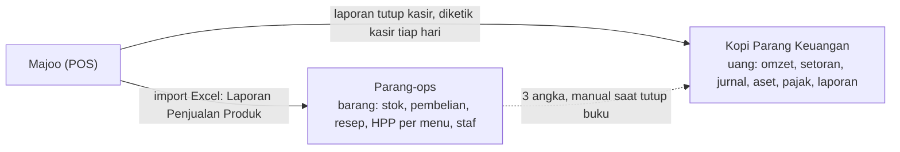
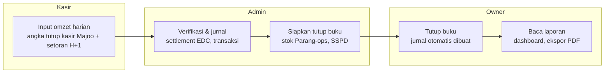

# Spesifikasi Web App Keuangan Kopi Parang

Per 20 Oktober 2026 · Kopi Parang

## Ringkasan

Tujuannya adalah memindahkan sistem keuangan Kopi Parang dari file Excel `KOPI_PARANG_LAPORAN_KEUANGAN_2026_v2.xlsx` ke web app multi-pengguna, dengan angka laporan yang **sama persis** dengan versi Excel.

Sistem Excel saat ini terdiri dari 18 sheet: 5 sheet input (Pengaturan, Omzet Harian, Jurnal, Aset Tetap, Akun) dan 13 sheet laporan atau hitungan yang semuanya otomatis. Web app mengikuti pola yang sama: data hanya masuk lewat form input, dan semua laporan dihitung oleh server dari data tersebut.

**Masuk lingkup:**

- Input omzet harian dari kasir, termasuk setoran per shift dan settlement EDC/QRIS
- Input jurnal transaksi (satu baris = satu debet, satu kredit) beserta tag event
- Daftar akun, saldo awal, daftar aset tetap, dan penyusutan otomatis
- Laporan Laba Rugi, Neraca, Arus Kas (metode langsung), Perubahan Ekuitas, Neraca Saldo, Buku Besar
- Rekap Omzet & KPI, Analisis Event, Rekonsiliasi Pajak (PBJT), Dashboard, dan daftar Review temuan
- Tutup buku bulanan, hak akses per peran, riwayat perubahan, ekspor ke Excel/PDF

**Di luar lingkup:** koneksi apa pun ke Majoo maupun ke Parang-ops (database, login, atau API bersama), stok per item, resep dan HPP per menu, absensi staf, penggajian, serta e-Faktur atau pelaporan pajak online.

**Aplikasi ini berdiri sendiri.** Kopi Parang punya dua aplikasi internal dengan tugas berbeda: Parang-ops mengurus barang dan operasional kedai, sedangkan aplikasi ini mengurus uang dan laporan keuangan. Keduanya tidak saling terhubung. Angka POS diambil dari laporan tutup kasir Majoo dan diinput manual. Tiga angka dari Parang-ops dipindahkan manual saat tutup buku, dengan aturan di bagian Batas dengan Parang-ops.

Acuan utama untuk tim: file Excel v2 tersebut. Jika ada perbedaan antara dokumen ini dan rumus di Excel, rumus Excel yang benar sampai disepakati lain.

Acuan tampilan: [prototipe yang bisa diklik](https://claude.ai/artifact/Frhygf7nHo4fRd26QGugxV), memakai data asli dan mesin hitung yang hasilnya sama dengan Excel. Kode mesin hitungnya bisa dipakai tim sebagai contoh implementasi rumus.

## Batas dengan Parang-ops

Parang-ops mencatat **barang**, aplikasi ini mencatat **uang**. Tidak ada data yang mengalir otomatis di antara keduanya, jadi aturan di bawah ini mencegah data dobel atau saling bertentangan. Gambaran Parang-ops di sini berdasarkan versi Juli 2026 (v56); tim perlu mencocokkannya dengan versi terbaru.

Majoo dibaca dua kali dari laporan berbeda, dan Parang-ops hanya menyerahkan tiga angka bulanan. Tidak ada garis yang berjalan otomatis.

### Siapa mencatat apa

| Kejadian | Parang-ops | Kopi Parang Keuangan |
| --- | --- | --- |
| Beli bahan untuk Stock List (susu, sirup, biji, cup, dll.) | Stock Purchase: qty, harga, supplier | Jurnal: Biaya Bahan Baku atau Biaya Penyajian, lawan kas atau utang |
| Terima biji dari Yantos Roastery | Stock Purchase dengan supplier Yantos | Jurnal pembelian ke Yantos (kas atau Utang Usaha) |
| Repack, prep sirup/premix, waste | Repacked Stock, Preparation Log, adjustment | Tidak dicatat; tercermin di nilai stok akhir bulan |
| Stok opname akhir bulan | Hitung fisik dan adjustment stok | Input nilai stok akhir, lalu jurnal penyesuaian persediaan |
| Penjualan | Import "Laporan Penjualan Produk" Majoo (per menu) | Input angka laporan tutup kasir Majoo (tunai, EDC/QRIS) dan setoran |
| Resep dan HPP per menu | Products / Recipe Management | Tidak dicatat |
| Absensi, jadwal, kebersihan | Team Attendance, Clean-Up Log | Tidak dicatat |
| Gaji dan bon karyawan | Tidak dicatat | Jurnal gaji; bon per karyawan di Omzet Harian |
| Beli peralatan (≥ Rp1 juta) | Tidak dicatat | Aset Tetap dan jurnal |
| Sewa, tagihan, pajak, prive, utang, event | Tidak dicatat | Jurnal |

### Tiga angka yang dipindahkan manual setiap tutup buku

| Angka | Diambil dari Parang-ops | Dipakai Keuangan untuk | Status |
| --- | --- | --- | --- |
| Nilai stok akhir bulan | Jumlah nilai semua stok (bahan, repacked, prepared) setelah stok opname | Jurnal penyesuaian persediaan, supaya HPP per bulan benar | Wajib |
| Total pembelian bulan itu | Jumlah nilai Stock Purchase bertanggal di bulan itu | Dibandingkan dengan jurnal Biaya Bahan Baku + Biaya Penyajian; menangkap nota yang hanya dicatat di satu aplikasi | Wajib |
| Total penjualan Majoo | Jumlah penjualan hasil import bulan itu | Dibandingkan dengan omzet tercatat di Omzet Harian | Opsional |

### Aturan agar tidak bertabrakan

- **Satu nota, dua catatan.** Nota belanja barang Stock List dicatat di Parang-ops (barang) dan di Keuangan (uang). Nomor nota ditulis di kedua aplikasi agar mudah dicocokkan.
- **Ejaan nama sama persis.** Nama karyawan dan supplier di tabel Pihak memakai ejaan yang sama dengan master Staff dan Suppliers di Parang-ops. Tidak ada ID bersama; yang disamakan hanya nama.
- **Majoo dibaca dari dua laporan berbeda.** Parang-ops dari laporan penjualan produk, Keuangan dari laporan tutup kasir. Selisih kecil wajar (diskon, void, pembulatan); di atas toleransi harus dicek.
- **Terpisah secara teknis.** Repository, database (misalnya `kopiparang_keuangan`), subdomain, nama cookie sesi, variabel environment, dan jadwal backup masing-masing sendiri. Jika memakai server PostgreSQL yang sama, buat database dan user database terpisah; user Keuangan tidak boleh punya akses ke database Parang-ops, dan sebaliknya.
- **PIN terpisah.** PIN kasir di aplikasi ini dikelola sendiri dan tidak disinkronkan dengan PIN staf Parang-ops.
- **Satu sumber per angka.** Nilai stok hanya dihitung di Parang-ops; laba, kas, dan utang hanya dihitung di Keuangan. Jangan menambah laporan keuangan di Parang-ops atau modul stok di Keuangan.

## Pengguna & hak akses

Ada tiga peran. Satu orang boleh memegang lebih dari satu peran, dan owner bisa menambah atau menonaktifkan pengguna.

| Modul | Owner | Admin keuangan | Kasir |
| --- | --- | --- | --- |
| Omzet harian: input angka tutup kasir Majoo | Lihat, ubah | Lihat, ubah | Input hari ini saja |
| Omzet harian: realisasi setoran & EDC | Lihat, ubah | Input, ubah | Input setoran shift sendiri |
| Jurnal transaksi | Lihat, ubah, hapus | Input, ubah | Tidak ada akses |
| Aset tetap | Lihat, ubah | Input, ubah | Tidak ada akses |
| Pihak (karyawan & supplier) | Ubah | Input, ubah | Tidak ada akses |
| Daftar akun & saldo awal | Ubah | Lihat | Tidak ada akses |
| Tutup buku: input angka Parang-ops & SSPD | Input, tutup, buka kembali | Input | Tidak ada akses |
| Pengaturan | Ubah | Lihat | Tidak ada akses |
| Semua laporan & dashboard | Lihat, ekspor | Lihat, ekspor | Tidak ada akses |
| Pengguna & riwayat perubahan | Kelola, lihat | Tidak ada akses | Tidak ada akses |

Aturan tambahan:

- Owner dan admin masuk dengan email, kata sandi, dan verifikasi 2 langkah. Kasir masuk dengan PIN 6 digit di HP atau tablet kasir. PIN ini dikelola di aplikasi ini dan tidak disinkronkan dengan PIN Parang-ops.
- Data di bulan yang sudah ditutup terkunci. Hanya owner yang bisa membuka kembali, dan tindakan itu tercatat di riwayat.
- Kasir tidak bisa mengubah omzet hari sebelumnya setelah admin memverifikasi realisasinya.
- Hapus data selalu berupa *soft delete* (ditandai batal, tidak dihapus permanen), supaya jejak audit tetap utuh.

## Modul & fitur

Ada 7 modul input dan 11 modul laporan. Hampir setiap modul punya padanan sheet di Excel v2, jadi tim bisa membuka sheet itu untuk melihat contoh tampilan dan angka yang diharapkan. Modul Pihak dan Tutup Buku baru, karena aplikasi ini terpisah dari Parang-ops.

### Modul input

| Modul | Sheet acuan | Fitur utama |
| --- | --- | --- |
| Omzet Harian | OMZET HARIAN | Satu baris per tanggal. Input angka laporan tutup kasir Majoo (tunai, EDC/QRIS), setoran tunai shift 1 dan 2, settlement EDC, compliment, bill owner, produk terjual, jumlah transaksi. Bon karyawan diisi per orang (pilih nama dari Pihak, isi nominal). Status per hari dihitung otomatis. Tampilan kalender bulanan dengan warna status. |
| Jurnal | JURNAL | Form satu transaksi: tanggal, akun debet, akun kredit (dropdown dari daftar akun), nominal, keterangan, nomor nota, tag event, pihak. Nomor bukti otomatis (JU-0001 dst). Filter per bulan, akun, event, jenis. Lampiran foto nota (opsional, fase 4). |
| Aset Tetap | ASET TETAP | Nama aset, tanggal perolehan, harga, masa manfaat (tahun). Jadwal penyusutan per bulan dan nilai buku tampil otomatis. |
| Pihak | (baru) | Daftar karyawan dan supplier. Ejaan nama harus sama dengan master Staff dan Suppliers di Parang-ops. Dipakai untuk bon karyawan, utang/piutang, dan pihak di jurnal. |
| Daftar Akun | AKUN | Kode, nama, kelompok, pos laporan, saldo normal, kategori arus kas, baris arus kas, saldo awal, rincian saldo awal per pihak. |
| Pengaturan | PENGATURAN | Nama usaha, tahun buku, bulan tutup buku, tarif PBJT, harga termasuk pajak (ya/tidak), akui estimasi PBJT kurang bayar (ya/tidak), target omzet, batas rasio biaya, batas selisih tunai, toleransi cek Parang-ops. |
| Tutup Buku | (baru) | Wizard bulanan: cek status omzet harian, konfirmasi tagihan rutin, input SSPD PBJT, input 3 angka dari Parang-ops, pratinjau jurnal otomatis, cek kesehatan data, kunci bulan. Riwayat cek dengan Parang-ops per bulan. |

### Modul laporan (hanya baca, bisa diekspor)

| Modul | Sheet acuan | Isi |
| --- | --- | --- |
| Dashboard | DASHBOARD | Kartu KPI (pendapatan bersih, laba kotor, omzet per hari, rata-rata per transaksi), grafik kinerja bulanan, struktur biaya, cek kesehatan data. |
| Laba Rugi | LABA RUGI | Multi-step per bulan Jan–Des + total, margin, EBITDA, indikator biaya vs batas di Pengaturan. |
| Neraca | NERACA | Posisi 1 Januari vs tanggal tutup buku, aset lancar/tidak lancar, liabilitas jangka pendek/panjang, ekuitas, cek keseimbangan. |
| Arus Kas | ARUS KAS | Metode langsung per bulan, tiga aktivitas, pindah dana antar-kas tidak dihitung, cek ke saldo kas. |
| Perubahan Ekuitas | PERUBAHAN EKUITAS | Ekuitas awal, setoran modal, laba bersih, prive, ekuitas akhir per bulan. |
| Neraca Saldo | NERACA SALDO | Saldo awal, mutasi, saldo akhir per akun (debet/kredit). |
| Buku Besar | BUKU BESAR | Pilih akun, tampil semua transaksi dengan saldo berjalan dan akun lawan. |
| Rekap Omzet | REKAP OMZET | Rekap omzet bulanan, selisih kasir, hari buka, rata-rata per hari dan per transaksi, pencapaian target. |
| Analisis Event | ANALISIS EVENT | Pendapatan, biaya, laba/rugi, dan biaya per Rp1 pendapatan untuk tiap tag event. |
| Pajak (PBJT) | PAJAK | Per bulan: omzet tercatat, omzet dilaporkan, PBJT terutang, PBJT dibayar, kurang bayar, cocokkan dengan jurnal. |
| Catatan (CALK) | CALK | Teks catatan dengan angka yang terisi otomatis dari laporan. Bagian teks bisa diedit owner. |

Sheet REVIEW di Excel tidak perlu dibuat ulang sebagai modul. Isinya cukup dijadikan daftar tugas internal tim keuangan.

## Model data

Semua nominal disimpan sebagai bilangan bulat Rupiah (`BIGINT`), bukan desimal atau float. Semua tabel transaksi punya kolom `created_by`, `created_at`, `updated_by`, `updated_at`, dan `voided_at` (untuk soft delete). Nama tabel di bawah hanya usulan; tim bebas menyesuaikan.

| Tabel | Kolom penting | Catatan |
| --- | --- | --- |
| `settings` | business\_name, fiscal\_year, closed\_month (1–12), pbjt\_rate, price\_includes\_tax (bool), accrue\_pbjt (bool), revenue\_target, food\_cost\_limit, payroll\_limit, occupancy\_limit, prime\_cost\_limit, net\_margin\_target, cash\_diff\_threshold (default 50.000), ops\_purchase\_tolerance\_pct (default 5%), ops\_sales\_tolerance\_pct (default 2%) | Satu baris per tahun buku. |
| `accounts` | code (unik), name (unik), group (ASET, LIABILITAS, EKUITAS, PENDAPATAN, BEBAN), report\_line, normal\_side (D/K), cash\_category (KAS, OPERASI, INVESTASI, PENDANAAN, NONKAS), cash\_flow\_line (OP1–OP7, IN1, FN1–FN3), opening\_balance, description, is\_active | Data awal: 35 akun dari sheet AKUN (lihat Lampiran). Akun yang sudah dipakai tidak boleh dihapus, hanya dinonaktifkan. |
| `opening_balance_details` | account\_id, party\_id, amount | Rincian saldo awal piutang dan utang per pihak. |
| `parties` | name (unik), type (karyawan, supplier, pemberi pinjaman, owner, lainnya), is\_active | Pengganti kolom "Sub Akun / Pihak" yang sekarang diketik bebas. Ejaan nama sama dengan master Parang-ops; tidak ada ID atau tabel bersama. |
| `events` | name, start\_date, notes | Pengganti kolom "Tag Event" yang sekarang diketik bebas. |
| `journal_entries` | voucher\_no (unik, JU-0001), date, description, receipt\_no, kind (UMUM, OTOMATIS, PENYESUAIAN), event\_id, party\_id, source\_type, source\_ref | `receipt_no` = nomor nota, untuk dicocokkan dengan Stock Purchase di Parang-ops. `source_*` diisi untuk jurnal otomatis, misalnya `daily_sales:2026-01`, `depreciation:2026-01`, `inventory:2026-10`. |
| `journal_lines` | entry\_id, account\_id, debit, credit | Simpan sebagai baris debet/kredit agar bisa menampung transaksi majemuk nanti. Form tetap sederhana (1 debet, 1 kredit), jadi tiap transaksi = 2 baris. Validasi: total debet = total kredit per entri. |
| `daily_sales` | date (unik), cash\_pos, edc\_pos, cash\_shift1, cash\_shift2, edc\_settled, compliment, owner\_bill, items\_sold, transactions, verified\_by, verified\_at | Angka POS dari laporan tutup kasir Majoo. Kolom turunan (total, selisih, omzet bersih, status) dihitung, tidak disimpan. Kosong (NULL) berbeda artinya dengan 0: kosong = belum direalisasi. |
| `daily_staff_bons` | date, party\_id, amount | Bon karyawan per orang per hari. Jumlahnya per tanggal = `staff_bon` di rumus omzet harian. |
| `fixed_assets` | name, acquired\_on, cost, useful\_life\_years, account\_id | Jadwal penyusutan dihitung dari kolom ini. |
| `tax_filings` | year, month, reported\_revenue, pbjt\_paid, sspd\_no, filed\_on | Input di wizard Tutup Buku: omzet yang dilaporkan ke Bapenda dan PBJT yang dibayar. |
| `ops_monthly_figures` | year, month, stock\_value, purchases\_total, sales\_total, entered\_by, entered\_at, note | Tiga angka dari Parang-ops, diinput manual saat tutup buku. `stock_value` dan `purchases_total` wajib, `sales_total` boleh kosong. |
| `event_notes` | event\_id, note | Keterangan manual di halaman Analisis Event. |
| `period_closings` | year, month, closed\_by, closed\_at, reopened\_by, reopened\_at | Riwayat tutup buku. |
| `users` | name, email, role (owner, admin, kasir), password\_hash, totp\_secret, pin\_hash, is\_active | Owner/admin: email + kata sandi + 2FA. Kasir: PIN. Tidak berbagi tabel pengguna dengan Parang-ops. |
| `audit_logs` | user\_id, table\_name, record\_id, action, before (JSON), after (JSON), at | Semua perubahan pada tabel di atas. |

Validasi yang wajib ada (menggantikan kolom "Cek" di Excel):

- Akun debet dan akun kredit wajib dipilih dari daftar, dan tidak boleh sama.
- Nominal harus lebih dari 0.
- Tanggal harus di tahun buku aktif dan di bulan yang belum ditutup.
- Satu tanggal hanya boleh punya satu baris omzet harian.

## Logika perhitungan

Semua laporan dihitung dari dua sumber saja: tabel `journal_lines` dan `daily_sales`, ditambah angka bulanan Parang-ops (ops\_monthly\_figures) dan saldo awal di `accounts`. Bulan setelah `closed_month` selalu tampil kosong di laporan bulanan. Rumus di bawah adalah terjemahan langsung dari rumus Excel v2.

### 1. Omzet harian (per tanggal)

- `total_pos` = cash\_pos + edc\_pos
- `total_realized` = cash\_shift1 + cash\_shift2 + edc\_settled
- `cash_diff` = cash\_pos − cash\_shift1 − cash\_shift2. Bernilai 0 jika kedua shift masih kosong.
- `edc_diff` = edc\_pos − edc\_settled. Bernilai 0 jika edc\_settled masih kosong.
- `unexplained_cash` = cash\_diff − staff\_bon − compliment − owner\_bill. Bernilai 0 jika kedua shift masih kosong.
- `diff_cost` = edc\_diff + unexplained\_cash
- `net_revenue` (omzet bersih) = total\_pos − diff\_cost
- `avg_ticket` = net\_revenue ÷ transactions
- `status`, dicek berurutan: kosong jika total\_pos = 0; "Belum direalisasi" jika cash\_pos > 0 dan kedua shift kosong; "EDC belum settle" jika edc\_pos > 0 dan edc\_settled kosong; "Cek selisih tunai" jika |unexplained\_cash| > Rp50.000; selain itu "OK". Batas Rp50.000 diambil dari Pengaturan (cash\_diff\_threshold). staff\_bon = jumlah bon semua karyawan di tanggal itu (tabel daily\_staff\_bons).

### 2. Jurnal otomatis bulanan

Saat bulan ditutup (atau setiap kali data sumber berubah selama bulan belum ditutup), sistem membuat atau memperbarui jurnal di bawah, bertanggal hari terakhir bulan itu. Admin tidak bisa mengedit jurnal ini secara manual.

| # | Debet | Kredit | Nominal | Jenis |
| --- | --- | --- | --- | --- |
| 1 | Piutang Usaha Cafe | Pendapatan Cafe | Σ net\_revenue bulan itu | OTOMATIS |
| 2 | Kas Tunai | Piutang Usaha Cafe | Σ (cash\_shift1 + cash\_shift2) | OTOMATIS |
| 3 | Kas Bank | Piutang Usaha Cafe | Σ edc\_settled | OTOMATIS |
| 4 | Piutang Lainnya | Piutang Usaha Cafe | Σ bon per karyawan; satu jurnal per karyawan dengan `party_id` | OTOMATIS |
| 5 | Biaya Compliment | Piutang Usaha Cafe | Σ compliment | OTOMATIS |
| 6 | Prive | Piutang Usaha Cafe | Σ owner\_bill | OTOMATIS |
| 7 | Beban Penyusutan Peralatan | Akumulasi Penyusutan Peralatan | Total penyusutan bulan itu (lihat poin 8) | OTOMATIS |
| 8 | Pajak Restoran | Utang Pajak Daerah (PBJT) | max(0, PBJT kurang bayar bulan itu), hanya jika `accrue_pbjt` = ya | PENYESUAIAN |
| 9 | Inventori | Biaya Bahan Baku | Penyesuaian persediaan (lihat di bawah). Jika hasilnya negatif, sisi debet dan kredit dibalik. | PENYESUAIAN |

Jika semua hari sudah direalisasi, jurnal 2–6 persis menghabiskan jurnal 1, sehingga saldo Piutang Usaha Cafe hanya berisi omzet yang belum disetor atau belum settle.

**Penyesuaian persediaan (jurnal 9).** Nominal = `stock_value` bulan itu (dari Parang-ops) − saldo akun Inventori sebelum jurnal 9. Positif berarti stok bertambah: Dr Inventori / Cr Biaya Bahan Baku, sehingga HPP turun. Negatif berarti stok berkurang: Dr Biaya Bahan Baku / Cr Inventori. Jurnal ini hanya dibuat jika `stock_value` bulan itu diisi; Januari–September 2026 tidak punya angka ini, jadi angka patokan tidak berubah. Karena pembelian selama ini langsung dibebankan, bulan pertama yang diisi akan menurunkan HPP sekali, lalu bulan-bulan berikutnya normal.

### 3. Mutasi dan saldo akun

- Mutasi akun per bulan = Σ debet − Σ kredit (bertanda: positif = debet).
- Saldo awal bertanda = +opening\_balance jika saldo normal D, −opening\_balance jika K.
- Saldo akhir = saldo awal bertanda + Σ mutasi bulan 1 s.d. closed\_month.
- Saldo awal Ekuitas Kopi Parang dihitung otomatis: total aset bersaldo normal D − total aset bersaldo normal K − total liabilitas, per 1 Januari.
- Neraca Saldo: saldo awal, mutasi debet, mutasi kredit, saldo akhir; kolom debet = max(saldo, 0), kolom kredit = max(−saldo, 0).
- Buku Besar: transaksi akun terpilih s.d. closed\_month, saldo berjalan mengikuti saldo normal akun, kolom "akun lawan" = sisi seberang jurnal.

### 4. Laba Rugi (per bulan + total s.d. closed\_month)

Akun pendapatan dibaca sebagai −mutasi, akun beban sebagai +mutasi.

- Pendapatan kotor = Pendapatan Cafe + Pendapatan non Cafe
- Pendapatan bersih = pendapatan kotor − Pajak Restoran
- Beban pokok penjualan = Biaya Bahan Baku + Biaya Penyajian
- Laba kotor = pendapatan bersih − beban pokok penjualan
- Beban usaha = jumlah 11 akun 6101–6111 (gaji, sewa, tagihan bulanan, marketing, perlengkapan, operasional harian, pemeliharaan, compliment, R&D, CSR, penyusutan)
- Laba usaha = laba kotor − beban usaha; EBITDA = laba usaha + penyusutan
- Lain-lain bersih = Pendapatan Lainnya − Biaya Lainnya
- Laba bersih = laba usaha + lain-lain bersih
- Rasio terhadap pendapatan bersih: margin kotor, margin bersih, food cost (HPP), payroll (gaji), occupancy (sewa), prime cost (HPP + gaji), marketing. Rasio yang melewati batas di Pengaturan diberi warna peringatan.

### 5. Neraca

- Dua kolom: 1 Januari (saldo awal) dan tanggal akhir bulan tutup buku (saldo akhir).
- Aset lancar: kas tunai, kas bank, kas warung, piutang usaha (cafe + non cafe), piutang lain-lain, persediaan, perlengkapan, beban dibayar di muka.
- Aset tidak lancar: peralatan dan akumulasi penyusutan (tampil negatif sebagai pengurang).
- Liabilitas dan ekuitas dibaca sebagai −saldo. Jangka pendek: utang usaha, utang PBJT, utang lain-lain. Jangka panjang: utang usaha jangka panjang.
- Ekuitas: modal pemilik, prive, laba tahun berjalan. Laba tahun berjalan = −(Σ mutasi akun PENDAPATAN + Σ mutasi akun BEBAN) s.d. closed\_month; di kolom 1 Januari bernilai 0.
- Cek: total aset − total liabilitas dan ekuitas harus 0.

### 6. Arus Kas (metode langsung)

- Ambil setiap jurnal yang **tepat satu** sisinya akun berkategori KAS (Kas Tunai, Kas Bank, Kas Warung). Jurnal kas-ke-kas (pindah dana) dan jurnal tanpa kas diabaikan.
- Akun lawan = sisi yang bukan kas. Efek kas = +nominal jika kas di sisi debet, −nominal jika kas di sisi kredit.
- Kelompokkan efek kas menurut `cash_flow_line` akun lawan: OP1 penerimaan dari pelanggan, OP2 lain-lain bersih, OP3 bahan baku & penyajian, OP4 gaji, OP5 sewa, OP6 beban operasional lain, OP7 PBJT, IN1 pembelian peralatan, FN1 prive, FN2 setoran modal, FN3 utang.
- Kas awal Januari = Σ saldo awal akun KAS; kas awal bulan berikutnya = kas akhir bulan sebelumnya; kas akhir = kas awal + kenaikan bersih.
- Cek: kas akhir harus sama dengan Σ saldo akhir akun KAS.

### 7. Perubahan Ekuitas

- Ekuitas awal Januari = −(saldo awal Ekuitas Kopi Parang + saldo awal Prive); bulan berikutnya = ekuitas akhir bulan sebelumnya.
- Setoran modal = −mutasi Ekuitas Kopi Parang; prive = −mutasi Prive; laba bersih dari Laba Rugi.
- Ekuitas akhir = awal + setoran + laba bersih + prive. Cek: harus sama dengan total ekuitas di Neraca.

### 8. Penyusutan aset tetap

- Mulai susut = tanggal 1 bulan setelah tanggal perolehan.
- Penyusutan per bulan = round(harga perolehan ÷ (masa manfaat × 12)).
- Dibebankan di bulan m jika m ≤ closed\_month dan mulai susut ≤ tanggal 1 bulan m < mulai susut + masa manfaat × 12 bulan.
- Akumulasi s.d. tutup buku = akumulasi awal tahun + Σ penyusutan; nilai buku = harga perolehan − akumulasi.
- Cek: total harga perolehan = saldo akun Peralatan, total akumulasi = saldo akun Akumulasi Penyusutan.

### 9. Pajak (PBJT)

- Omzet tercatat bulan m = Σ total\_pos.
- DPP = omzet ÷ (1 + tarif) jika harga termasuk pajak, selain itu = omzet.
- PBJT terutang = round(DPP × tarif).
- PBJT kurang bayar = terutang − pbjt\_paid (dari `tax_filings`).
- % dilaporkan = reported\_revenue ÷ omzet tercatat; selisih omzet = omzet tercatat − reported\_revenue.
- Dibayar menurut jurnal = −Σ efek kas dengan akun lawan Pajak Restoran di bulan m. Tampilkan tanda cocok jika sama dengan pbjt\_paid.

### 10. Analisis Event

- Pendapatan event = Σ nominal jurnal bertag event itu yang akun kreditnya berkelompok PENDAPATAN.
- Biaya event = Σ nominal jurnal bertag event itu yang akun debetnya berkelompok BEBAN.
- Laba (rugi) = pendapatan − biaya; biaya per Rp1 pendapatan = biaya ÷ pendapatan; tanggal pertama = tanggal jurnal paling awal bertag event itu.

### 11. Rekap Omzet & Dashboard

- Per bulan (termasuk bulan berjalan): omzet POS (tunai, EDC), realisasi, selisih tunai dan penjelasannya, selisih tak terjelaskan, selisih EDC, omzet bersih.
- Hari buka = jumlah hari dengan total\_pos > 0. Rata-rata per hari = omzet bersih ÷ hari buka. Avg ticket = omzet bersih ÷ jumlah transaksi.
- Pencapaian target = omzet bersih ÷ target; pertumbuhan = omzet bersih bulan ini ÷ bulan lalu − 1.
- Hari perlu dicek = jumlah hari buka yang statusnya bukan "OK".
- Dashboard memakai angka Laba Rugi dan Rekap Omzet s.d. closed\_month. Struktur biaya: HPP, gaji, sewa, marketing, tagihan bulanan, beban lainnya, sisa laba.
- Cek kesehatan data (tampil hijau/merah): neraca seimbang, neraca saldo seimbang, kas di arus kas = kas di neraca, ekuitas di perubahan ekuitas = ekuitas di neraca.

### 12. Cek dengan Parang-ops (per bulan)

- Pembelian menurut Keuangan = Σ debet ke Biaya Bahan Baku + Biaya Penyajian dari jurnal manual (jenis UMUM) di bulan itu. Jurnal penyesuaian tidak ikut.
- Selisih pembelian = `purchases_total` (Parang-ops) − pembelian menurut Keuangan. Ditandai merah jika |selisih| > `ops_purchase_tolerance_pct` × pembelian menurut Keuangan. Penyebab umum: nota hanya dicatat di satu aplikasi, beda tanggal, atau belanja non-stok yang dibebankan ke akun bahan baku.
- Selisih omzet = `sales_total` (Parang-ops) − omzet tercatat (Σ total\_pos). Hanya dihitung jika `sales_total` diisi; ditandai jika |selisih| > `ops_sales_tolerance_pct` × omzet tercatat.
- Kedua cek ini **tidak** memblokir tutup buku. Hasilnya tampil di wizard dan di riwayat cek per bulan, dan owner bisa menambah catatan.

## Alur kerja

Data masuk setiap hari dari kasir dan admin, lalu owner menutup buku sekali sebulan. Laporan resmi hanya memuat bulan yang sudah ditutup.

Langkah tutup buku yang harus dipandu sistem (wizard satu halaman):

1. Tampilkan hari-hari yang statusnya bukan "OK" di bulan itu. Owner bisa lanjut, tapi harus mencentang konfirmasi.
2. Minta konfirmasi bahwa semua tagihan rutin (gaji, sewa, listrik, internet) sudah dijurnal.
3. Minta input data SSPD PBJT bulan itu (omzet dilaporkan, PBJT dibayar).
4. Minta input 3 angka dari Parang-ops setelah stok opname di sana selesai: nilai stok akhir (wajib), total pembelian (wajib), total penjualan Majoo (opsional). Tampilkan langsung selisih pembelian dan omzet terhadap toleransi.
5. Pratinjau semua jurnal otomatis, termasuk penyesuaian persediaan, lalu jalankan 4 cek kesehatan data.
6. Kunci bulan itu, naikkan `closed_month` di Pengaturan, dan simpan riwayat di `period_closings`.

Urutan antar-aplikasi di akhir bulan: stok opname dan adjustment di Parang-ops dulu, baru angka Parang-ops diambil dan tutup buku di Keuangan.

## Migrasi data & uji kecocokan

Web app baru boleh dipakai jika laporan Januari–September 2026 hasil hitungan web **sama persis sampai rupiah** dengan Excel v2. Rumus di bagian Logika perhitungan sudah diuji ulang dengan skrip terpisah, dan hasilnya cocok dengan Excel di semua akun.

Data yang dipindahkan dari Excel:

| Data | Jumlah | Sumber |
| --- | --- | --- |
| Akun + saldo awal 1 Jan | 35 akun, 6 rincian per pihak | Sheet AKUN |
| Omzet harian | 281 hari terisi (1 Jan – 11 Okt 2026) | Sheet OMZET HARIAN, kolom input saja |
| Jurnal manual (UMUM) | 1.261 transaksi | Sheet JURNAL, kolom A–I |
| Aset tetap | 18 aset | Sheet ASET TETAP |
| Data SSPD PBJT | 9 bulan | Sheet PAJAK, kolom omzet dilaporkan & PBJT dibayar |
| Pengaturan | 1 baris | Sheet PENGATURAN |

Jurnal berjenis OTOMATIS (84 baris) dan PENYESUAIAN (12 baris) **tidak** diimpor. Sistem harus membuatnya ulang sendiri, dan hasilnya menjadi bagian dari uji.

Angka patokan dengan bulan tutup buku = September 2026:

| Angka | Nilai Excel v2 (Rp) |
| --- | --- |
| Pendapatan bersih Jan–Sep | 795.505.902 |
| Laba kotor Jan–Sep | 456.926.368 |
| Laba (rugi) bersih Jan–Sep | −54.996.702 |
| Laba (rugi) bersih Januari | −51.148.041 |
| Total aset per 30 Sep | 101.739.014 |
| Total liabilitas per 30 Sep | 74.619.781 |
| Total ekuitas per 30 Sep | 27.119.233 |
| Kas tunai / kas bank / kas warung per 30 Sep | 51.913.400 / −2.739.792 / 4.108.000 |
| Akumulasi penyusutan per 30 Sep | 2.564.119 |
| Omzet bersih per hari buka (rata-rata) | 3.179.317 |

Langkah migrasi:

1. Buat skrip impor yang membaca file Excel v2 langsung (bukan ketik ulang), dan bisa dijalankan berkali-kali di database uji.
2. Ubah teks bebas menjadi relasi: nama akun → `account_id`, tag event → `events`, sub akun/pihak → `parties`. Tampilkan daftar nama yang tidak cocok untuk dibereskan manual.
3. Jalankan pembuatan jurnal otomatis untuk Januari–September.
4. Bandingkan saldo akhir setiap akun per bulan dengan sheet MUTASI, lalu semua angka patokan di atas. Selisih 1 rupiah pun harus dicari penyebabnya (biasanya pembulatan).
5. Jalankan Excel dan web secara paralel selama satu bulan penuh (misalnya Oktober), lalu bandingkan lagi sebelum Excel dihentikan.

Catatan migrasi terkait pemisahan dari Parang-ops:

- **Bon karyawan lama** di Excel hanya berupa total per hari. Impor sebagai satu pihak "Bon karyawan (data Excel)". Mulai go-live, bon dicatat per karyawan.
- **Pihak** diisi dari kolom Sub Akun/Pihak di Excel, lalu ejaannya disamakan dengan master Staff dan Suppliers di Parang-ops.
- **Angka Parang-ops** untuk Januari–September tidak diimpor, sehingga jurnal penyesuaian persediaan tidak dibuat untuk bulan-bulan itu dan angka patokan tetap berlaku. Isi angka Parang-ops mulai bulan pertama tutup buku di web.

## Kebutuhan non-fungsional

Ini data keuangan dan pajak usaha, jadi keamanan dan jejak audit sama pentingnya dengan fitur.

| Area | Kebutuhan |
| --- | --- |
| Login | Owner dan admin: email + kata sandi yang kuat + verifikasi 2 langkah. Kasir: PIN 6 digit, dikunci 15 menit setelah 5 kali salah. Sesi berakhir setelah 12 jam tidak aktif (kasir: 8 jam). |
| Hak akses | Dicek di server untuk setiap permintaan, bukan hanya disembunyikan di tampilan. |
| Pemisahan dari Parang-ops | Repository, database, user database, subdomain, nama cookie sesi, variabel environment, dan backup sendiri. Tidak ada API, tabel, atau login bersama. Lihat bagian Batas dengan Parang-ops. |
| Teknologi | Disarankan stack yang sama dengan Parang-ops (React + TypeScript + Tailwind, Express + TypeScript, PostgreSQL via Prisma) supaya tim tidak perlu belajar hal baru, tetapi sebagai project yang benar-benar terpisah. |
| Jejak audit | Setiap tambah, ubah, batal, tutup buku, dan buka kembali tercatat di `audit_logs` beserta nilai sebelum dan sesudah. Tidak bisa dihapus dari aplikasi. |
| Backup | Backup database otomatis harian, disimpan minimal 30 hari di lokasi terpisah. Uji pemulihan sekali per 3 bulan. |
| Ekspor | Semua laporan bisa diekspor ke Excel (.xlsx) dan PDF dengan format rapi (kop Kopi Parang, periode, tanggal cetak). |
| Tampilan mobile | Halaman Omzet Harian dan Dashboard harus nyaman dipakai di HP (layar 360 px). Halaman laporan cukup nyaman di laptop dan tablet. |
| Performa | Laporan tahunan dengan 5.000 jurnal tampil di bawah 2 detik. Hitung di database (query agregat), bukan memuat semua baris ke browser. |
| Format angka | Rupiah tanpa desimal, pemisah ribuan titik (1.234.567), angka negatif dalam kurung atau tanda minus, tanggal format Indonesia (12 Okt 2026). |
| Data pribadi | Data gaji per karyawan tidak disimpan di aplikasi ini (sama seperti Excel v2, yang sengaja tidak membawa sheet GAJI). |
| Lingkungan | Minimal dua lingkungan: uji (staging) dan produksi. Data asli tidak dipakai di laptop pengembang tanpa izin owner. |

## Tahapan pengerjaan

Kerjakan dalam 4 fase. Fase 1 dan 2 sudah cukup untuk menggantikan Excel; fase 3 dan 4 adalah tambahan nilai. Tim developer yang menentukan estimasi waktu tiap fase.

1. **Fase 1: Fondasi & input harian.** Login dan peran (email + 2FA untuk owner/admin, PIN untuk kasir), Pengaturan, Daftar Akun, Pihak, Omzet Harian (termasuk tampilan HP untuk kasir dan bon per karyawan), Jurnal (dengan nomor nota), Aset Tetap, jejak audit.
   - Selesai jika: kasir bisa input omzet dari HP, admin bisa input jurnal, dan semua validasi di bagian Model data berjalan.
2. **Fase 2: Mesin laporan & tutup buku.** Jurnal otomatis (termasuk penyesuaian persediaan), Neraca Saldo, Buku Besar, Laba Rugi, Neraca, Arus Kas, Perubahan Ekuitas, cek kesehatan data, wizard tutup buku dengan input angka Parang-ops dan SSPD, riwayat cek Parang-ops, skrip migrasi.
   - Selesai jika: semua angka patokan di bagian Migrasi cocok sampai rupiah, lalu Excel dan web berjalan paralel selama satu bulan tanpa selisih.
3. **Fase 3: Analisis & ekspor.** Dashboard dengan grafik, Rekap Omzet, Analisis Event, Pajak (PBJT), CALK, ekspor Excel/PDF.
   - Selesai jika: owner bisa melihat dashboard dari HP dan mengunduh paket laporan bulanan dalam satu PDF.
4. **Fase 4: Pengembangan lanjutan (opsional).** Lampiran foto nota, notifikasi (misalnya "setoran kemarin belum diisi"), anggaran per event, laporan pembanding antarbulan. Integrasi dengan Majoo atau Parang-ops **tidak** direncanakan; jika kelak dibutuhkan, dibahas sebagai proyek tersendiri.

Pertanyaan terbuka yang perlu diputuskan owner sebelum fase 2:

- [x] Bon karyawan dicatat per karyawan, dengan nama sama seperti master Staff di Parang-ops. (Diputuskan 20 Okt 2026.)
- [ ] Batas selisih tunai Rp50.000 untuk status "Cek selisih tunai": tetap atau diubah?
- [ ] Apakah selisih EDC (MDR) tetap mengurangi omzet seperti sekarang, atau dicatat sebagai beban administrasi bank?
- [ ] Siapa yang mengambil 3 angka dari Parang-ops setiap akhir bulan, dan tanggal berapa stok opname di Parang-ops dilakukan?
- [ ] Toleransi cek pembelian (usulan 5%) dan cek omzet (usulan 2%) sudah sesuai?
- [ ] Apakah tim memakai server PostgreSQL yang sama dengan Parang-ops (dengan database terpisah) atau server sendiri?

## Lampiran: daftar akun & pengaturan

Daftar akun awal yang diimpor dari sheet AKUN (35 akun). Saldo awal Ekuitas Kopi Parang tidak diinput, tapi dihitung dari aset dikurangi liabilitas per 1 Januari.

| Kode | Nama akun | Kelompok | Normal | Kategori kas | Baris arus kas | Saldo awal 1 Jan (Rp) |
| --- | --- | --- | --- | --- | --- | --- |
| 1101 | Kas Tunai | ASET | D | KAS | — | 26.605.500 |
| 1102 | Kas Bank | ASET | D | KAS | — | 81.982.785 |
| 1103 | Kas Warung | ASET | D | KAS | — | 3.000.000 |
| 1201 | Piutang Usaha Cafe | ASET | D | OPERASI | OP1 | 4.500.000 |
| 1202 | Piutang Usaha non Cafe | ASET | D | OPERASI | OP1 | 0 |
| 1203 | Piutang Lainnya | ASET | D | OPERASI | OP2 | 3.000.000 |
| 1301 | Inventori | ASET | D | OPERASI | OP3 | 0 |
| 1302 | Perlengkapan | ASET | D | OPERASI | OP6 | 0 |
| 1303 | Beban Dibayar di Muka | ASET | D | OPERASI | OP6 | 0 |
| 1501 | Peralatan | ASET | D | INVESTASI | IN1 | 0 |
| 1502 | Akumulasi Penyusutan Peralatan | ASET | K | NONKAS | — | 0 |
| 2101 | Utang Usaha Lancar | LIABILITAS | K | OPERASI | OP6 | 0 |
| 2102 | Utang Pajak Daerah (PBJT) | LIABILITAS | K | OPERASI | OP7 | 0 |
| 2103 | Utang Lainnya | LIABILITAS | K | PENDANAAN | FN3 | 3.567.600 |
| 2201 | Utang Usaha Jangka Panjang | LIABILITAS | K | PENDANAAN | FN3 | 2.420.000 |
| 3101 | Ekuitas Kopi Parang | EKUITAS | K | PENDANAAN | FN2 | 113.100.685 (otomatis) |
| 3102 | Prive | EKUITAS | D | PENDANAAN | FN1 | 0 |
| 4101 | Pendapatan Cafe | PENDAPATAN | K | OPERASI | OP1 | 0 |
| 4102 | Pendapatan non Cafe | PENDAPATAN | K | OPERASI | OP1 | 0 |
| 4901 | Pajak Restoran | PENDAPATAN | D | OPERASI | OP7 | 0 |
| 5101 | Biaya Bahan Baku | BEBAN | D | OPERASI | OP3 | 0 |
| 5102 | Biaya Penyajian | BEBAN | D | OPERASI | OP3 | 0 |
| 6101 | Beban Gaji | BEBAN | D | OPERASI | OP4 | 0 |
| 6102 | Biaya Sewa Tempat | BEBAN | D | OPERASI | OP5 | 0 |
| 6103 | Biaya Tagihan Bulanan | BEBAN | D | OPERASI | OP6 | 0 |
| 6104 | Biaya Marketing & Promosi | BEBAN | D | OPERASI | OP6 | 0 |
| 6105 | Beban Perlengkapan | BEBAN | D | OPERASI | OP6 | 0 |
| 6106 | Biaya Operasional Harian | BEBAN | D | OPERASI | OP6 | 0 |
| 6107 | Biaya Pemeliharaan | BEBAN | D | OPERASI | OP6 | 0 |
| 6108 | Biaya Compliment | BEBAN | D | OPERASI | OP6 | 0 |
| 6109 | Biaya R&D | BEBAN | D | OPERASI | OP6 | 0 |
| 6110 | Dana Sosial & CSR | BEBAN | D | OPERASI | OP6 | 0 |
| 6111 | Beban Penyusutan Peralatan | BEBAN | D | NONKAS | — | 0 |
| 7101 | Pendapatan Lainnya | PENDAPATAN | K | OPERASI | OP2 | 0 |
| 7201 | Biaya Lainnya | BEBAN | D | OPERASI | OP2 | 0 |

Nilai Pengaturan saat ini (tahun buku 2026):

| Parameter | Nilai |
| --- | --- |
| Bulan tutup buku terakhir | 9 (September) |
| Tarif PBJT | 10% |
| Harga menu sudah termasuk PBJT | Ya (pajak = 10/110 dari omzet) |
| Akui estimasi PBJT kurang bayar | Ya |
| Target omzet bulanan | Rp100.000.000 |
| Batas food cost / payroll / sewa / prime cost | 35% / 30% / 10% / 65% |
| Target net margin minimal | 10% |
| Batas selisih tunai per hari | Rp50.000 |
| Toleransi cek pembelian dengan Parang-ops | 5% (usulan) |
| Toleransi cek omzet dengan Parang-ops | 2% (usulan) |
